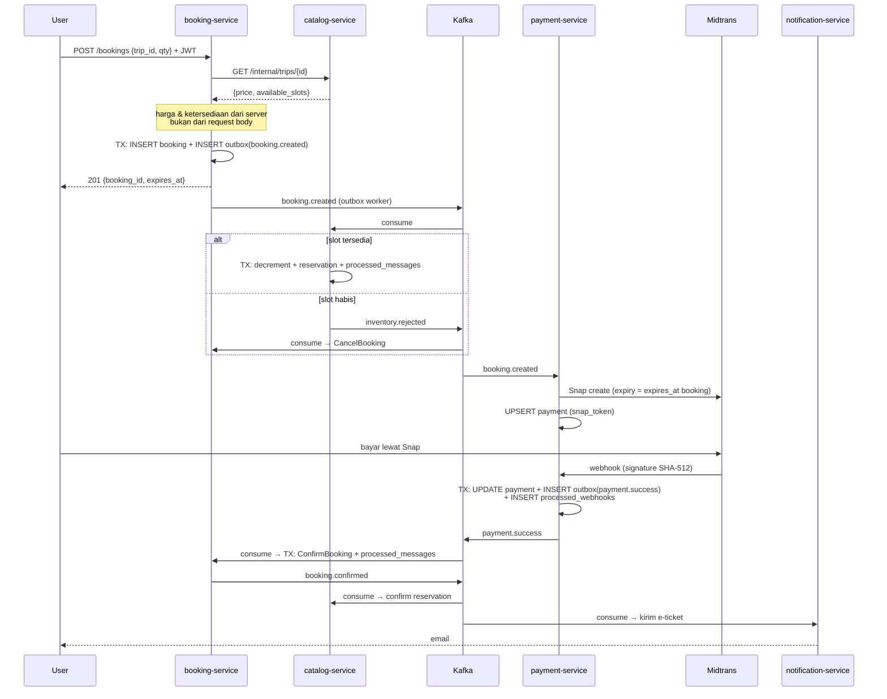

# TripNest — Audit Bug, Definisi Flow, dan Plan Revisi

Disusun 19 Agustus 2026 · commit `5d5ce8e` · target: **portofolio / showcase**

Dokumen ini menggantikan roadmap di `EVALUASI-TRIPNEST.md`. Isinya tiga bagian:
bagian 1 daftar bug lengkap, bagian 2 definisi flow (bisnis + teknis) yang sekarang belum ada,
bagian 3 rencana kerja yang urutannya mengikuti temuan.

**Catatan metode:** semua temuan berasal dari pembacaan kode. Saya mencoba menjalankan
`go build` dan `go vet` untuk verifikasi, tapi registry modul Go diblokir dari lingkungan ini,
jadi tidak ada temuan yang dikonfirmasi lewat kompilasi. Kolom "Cara cek" di tabel bug berisi
langkah untuk memverifikasi sendiri.

---

# Bagian 1 — Daftar Bug

56 temuan. Kolom **P** = prioritas: **P0** uang/keamanan, **P1** kehilangan data atau salah hasil,
**P2** kualitas dan operasional.

## 1.1 Uang dan keamanan (P0)

| # | Bug | Lokasi | Cara cek |
|---|---|---|---|
| B1 | **Harga booking dikirim dari browser.** Handler cuma cek `TotalAmount > 0`. Ubah URL jadi `?price=1000` → trip 5 juta dibayar Rp1.000, dan Midtrans memprosesnya. | `booking-service/internal/handler/handler.go` → `CreateBooking`; `frontend/app/page.tsx` → `onBook` | Buka `/booking?tripId=<id>&price=1000` lalu klik konfirmasi |
| B2 | **`user_id` dipercaya dari client.** Tidak ada middleware JWT di service manapun. `cfg.JWTSecret` dimuat di booking-service tapi tidak pernah dipakai. | `booking-service/internal/config/config.go`; grep `JWTSecret` di seluruh repo | `curl -X POST localhost:8081/bookings` tanpa header Authorization → berhasil |
| B3 | **Admin login palsu.** Kredensial `admin`/`admin123` hardcoded di JS client, dan `admin_logged_in` **tidak pernah dibaca sebagai guard** — hanya di-`set` dan di-`remove`. `/admin/*` terbuka tanpa login. | `frontend/app/admin/login/page.tsx`; grep `admin_logged_in` | Buka `/admin/trips` di incognito |
| B4 | **Endpoint admin backend tanpa auth.** `POST/PUT/DELETE /trips`, `POST /seed`, `POST /inventory`, `PATCH /inventory/{id}`, `GET /payments` semuanya publik. | `search-service/cmd/api/main.go`; `inventory-service/internal/handler`; `payment-service/internal/handler` | `curl -X DELETE localhost:8083/trips/<id>` |
| B5 | **`GET /payments` membocorkan data pembayaran** — seluruh baris termasuk `snap_token` dan `raw_notification`. | `payment-service/internal/handler/handler.go` → `ListPayments` | `curl localhost:8082/payments` |
| B6 | **`GET /payments/snap-token` publik dan bisa memicu transaksi Midtrans baru.** Kalau payment belum ada, endpoint ini memanggil `ProcessPayment`. Enumerasi booking ID → habiskan kuota Midtrans + ambil token orang lain. | `payment-service/internal/service/service.go` → `GetPaymentByBookingID` | `curl "localhost:8082/payments/snap-token?booking_id=<id-orang-lain>"` |
| B7 | **`backend/user-service/.env` ter-commit** (berisi `JWT_SECRET`, `DATABASE_URL`). Tidak ada `.gitignore` di root sama sekali. | `git ls-files \| grep env` | — |
| B8 | **JWT secret default lemah.** `super-secret-key` di kode, `dev-secret` di `docker-compose.yml`. Siapa pun bisa menandatangani token admin sendiri. | `user-service`/`booking-service` `config.go`; `docker-compose.yml` | — |
| B9 | **Booking `EXPIRED` masih bisa dibayar.** Snap dibuat tanpa `expiry`, jadi token valid ~24 jam sementara booking kedaluwarsa 15 menit. Setelah itu `GetPaymentByBookingID` tetap melayani token, user bayar, webhook masuk, `ConfirmBooking` hanya transisi dari `PENDING_PAYMENT` → no-op. **Uang masuk, booking tetap EXPIRED, tidak ada refund.** | `payment-service/internal/midtrans/client.go` → payload tanpa `expiry`; `booking-service/internal/service/service.go` → `ConfirmBooking` | Buat booking, tunggu 15 menit, bayar |
| B10 | **Regex injection di pencarian.** `params.Destination` masuk langsung ke `$regex` tanpa escape. Kirim `destination=(a+)+$` → MongoDB hang (ReDoS). | `search-service/internal/repository/repository.go` → `Search` | `curl "localhost:8083/search?destination=(a%2B)%2B\$"` |

## 1.2 Kehilangan data dan hasil salah (P1)

| # | Bug | Lokasi | Catatan |
|---|---|---|---|
| B11 | **Outbox tidak transaksional.** Di booking-service, `AddOutboxEvent` dijalankan dalam `go func()` terpisah setelah `repo.Create`, error-nya cuma di-`Printf`. Tidak ada satu pun `BeginTx` di seluruh `booking-service/internal/repository`. Di payment-service, `ApplyWebhookResult` punya tx sendiri lalu `AddOutboxEvent` dipanggil di luarnya. | `booking-service/internal/service/service.go` → `CreateBooking`; `payment-service/internal/service/service.go` → `HandleWebhook` | Ini membatalkan klaim outbox di README |
| B12 | **Idempotensi ditandai sebelum diproses.** `MarkMessageProcessed` di-commit lebih dulu; kalau handler gagal errornya cuma di-log dan retry berikutnya di-skip sebagai duplikat. Ini **at-most-once**, bukan at-least-once. Terjadi di booking, payment, dan inventory. | ketiga `cmd/api/main.go` | Pembayaran sukses tapi booking tidak pernah `CONFIRMED` |
| B13 | **`go svc.ProcessPayment(ctx, event)`** — fire-and-forget, return error dibuang total, dan pakai ctx milik consumer loop. | `payment-service/cmd/api/main.go` | |
| B14 | **Consumer mati permanen saat error.** `break` (bukan `continue`) pada error `ReadMessage`: 1× di payment-service, 4× di inventory-service. Satu blip Kafka = consumer mati sampai container restart. booking-service sudah benar. | `payment-service/cmd/api/main.go`; `inventory-service/cmd/api/main.go` | |
| B15 | **Race `midtrans_order_id`.** `UpsertInitiated` pakai `ON CONFLICT (booking_id) DO UPDATE` yang menimpa `midtrans_order_id`, sementara `buildOrderID` menyisipkan timestamp sehingga selalu unik. Kalau consumer Kafka dan request HTTP snap-token sama-sama lolos cek `existing == nil`, dua transaksi Snap dibuat dan order ID kedua menimpa yang pertama. User bayar pakai token pertama → `ApplyWebhookResult` (`WHERE midtrans_order_id = ...`) match 0 baris → error → **500 ke Midtrans selamanya**. | `payment-service/internal/repository/repository.go` → `UpsertInitiated`, `ApplyWebhookResult` | Jendelanya sempit tapi nyata |
| B16 | **`isIgnorableWebhookError` menelan `"not found"`.** Webhook untuk payment yang tidak ada dibalas `200 OK` dan hilang tanpa jejak. Klasifikasi error berbasis `strings.Contains` secara umum rapuh. | `payment-service/internal/service/service.go`; `handler.go` | |
| B17 | **Overbooking.** `ReserveSlot` gagal saat slot habis → `service.ReserveSlot` mengembalikan error → main.go cuma `log.Printf`. Booking tetap lanjut ke pembayaran. | `inventory-service/internal/service/service.go`; `repository.go` → `ReserveSlot` | |
| B18 | **Inventory tidak pernah terisi.** Trip hidup di MongoDB (search-service), inventory di Postgres (inventory-service), dan **tidak ada apa pun yang menghubungkan keduanya**. Form admin punya field `available_slots` tapi hanya menulis ke Mongo. Karena `inventory_reservations.resource_id` punya FK ke `inventory(resource_id)` dan `UPDATE inventory ... WHERE resource_id = $1` selalu kena 0 baris, **setiap `ReserveSlot` gagal**. inventory-service praktis mati di flow default. | `search-service` vs `inventory-service`; `frontend/app/admin/trips/page.tsx` | Ini akar dari B17 dan B19 |
| B19 | **Dua sumber kebenaran stok.** `available_slots` ada di Mongo (search) dan Postgres (inventory), tidak pernah disinkronkan. Frontend menampilkan angka Mongo yang tidak pernah berkurang — "Sisa N kursi" selalu salah. | `search-service/internal/model/listing.go`; `inventory-service/internal/model/inventory.go` | |
| B20 | **Cache Redis tidak di-invalidasi.** `Create`/`Update`/`Delete` diteruskan ke Mongo tanpa menghapus key `search:*`. Hasil search basi sampai TTL 60 detik habis. | `search-service/internal/repository/cached_repository.go` | |
| B21 | **Outbox worker tidak aman multi-instance.** `SELECT ... WHERE status='PENDING'` tanpa `FOR UPDATE SKIP LOCKED`. Dua replika → event dipublikasikan dua kali. | ketiga `repository.go` → `FetchPendingOutboxEvents` | Membatalkan klaim "horizontally scalable" |
| B22 | **Retry outbox tak terbatas.** `MarkOutboxEventFailed` hanya menaikkan `retry_count`, tidak pernah menset status `FAILED`. Event yang rusak permanen di-retry tiap 2 detik selamanya. Tidak ada backoff, tidak ada dead-letter. | ketiga `repository.go` | |
| B23 | **`inventory.reserved` dipublikasikan tapi tidak ada consumer-nya.** Event mati. | `inventory-service/internal/service/service.go` | |
| B24 | **Slot `CONFIRMED` tidak pernah bisa dilepas.** `ReleaseReservation` return lebih awal untuk status `CONFIRMED`. Kalau nanti ada pembatalan/refund, slot hilang selamanya. | `inventory-service/internal/repository/repository.go` | |

## 1.3 Kualitas, data, dan operasional (P2)

| # | Bug | Lokasi |
|---|---|---|
| B25 | Error internal Postgres dikirim mentah ke client lewat `WriteError(w, 500, err)` — membocorkan struktur skema | `common/utils/json.go` + semua handler |
| B26 | Register email duplikat → `500` (seharusnya `409`); tidak ada validasi format email atau kekuatan password | `user-service/internal/handler/handler.go` |
| B27 | Tidak ada rate limit di `/login` — brute force bebas | `user-service/cmd/api/main.go` |
| B28 | `DECIMAL(10,2)` → maksimum Rp 99.999.999,99. Trip di atas 100 juta akan error insert | migrasi `bookings`, `payments` |
| B29 | Uang sebagai `float64`, dikonversi `int64(math.Round(...))` ke Midtrans. Tidak ada field `currency` di mana pun | `booking`/`payment` model |
| B30 | Data customer Midtrans hardcoded: `"TripNest Customer"`, `user@tripnest.com`, `08123456789`. Struk dan email Midtrans salah semua | `payment-service/internal/service/service.go` → `ProcessPayment` |
| B31 | Snap tanpa `expiry` (penyebab B9) dan tanpa `item_details` | `payment-service/internal/midtrans/client.go` |
| B32 | Log membocorkan data: `MIDTRANS PAYLOAD: %+v`, `MIDTRANS RAW RESPONSE`, dan body booking lengkap | `payment-service` service + midtrans client |
| B33 | Seed data harga `150`–`300` (skala USD) tapi diformat sebagai Rupiah → "Rp 150". Dan 2 dari 5 tanggal seed (Jun & Jul 2026) sudah lewat per hari ini. Tidak ada validasi tanggal trip harus di masa depan | `search-service/internal/repository/repository.go` → `Seed` |
| B34 | `Update`/`Delete` trip mengembalikan `mongo.ErrNoDocuments` → handler membalas `500`, bukan `404` | `search-service/internal/handler/handler.go` |
| B35 | `mongo.Connect` tanpa `Ping` (error koneksi baru muncul di query pertama) dan tanpa `Disconnect` saat shutdown | `search-service/internal/repository/repository.go` |
| B36 | Migrasi `000001` dan `000002` booking sama-sama membuat `expires_at` — tanda migrasi lama pernah diedit setelah diterapkan. Ada juga dua mekanisme migrasi paralel: `golang-migrate` di dalam service dan `scripts/db-setup.sh` dengan tabel `schema_migrations` sendiri | `booking-service/migrations`; `backend/scripts/db-setup.sh` |
| B37 | `go.work` mendaftarkan 3 modul yang isinya cuma `go.mod` + `go.sum` kosong. Saya konfirmasi ketiganya menghasilkan `go: warning: "./..." matched no packages` | `backend/go.work` |
| B38 | Dockerfile menjalankan `go mod tidy` saat build (tidak reproducible), pakai `alpine:latest` tanpa pin, jalan sebagai root. Compose tidak punya healthcheck untuk service (hanya kafka & postgres) | semua `Dockerfile`; `docker-compose.yml` |
| B39 | Kafka masih pakai Zookeeper; sejak Kafka 3.x, KRaft menghilangkan satu container | `docker-compose.yml` |

## 1.4 Frontend

| # | Bug | Lokasi |
|---|---|---|
| B40 | Riwayat booking disimpan di `localStorage` (`my_bookings`). Hilang saat clear browser, tidak sinkron antar device, tidak per-user. Backend punya `GetByUserID` tapi tidak ada endpoint yang mengeksposnya | `app/my-bookings/page.tsx` |
| B41 | Token JWT di `localStorage` — terbaca oleh XSS | `lib/api.ts` |
| B42 | `localhost:8081` hardcoded di payment page, `localhost:8082` hardcoded di route handler. Satu-satunya tempat yang tidak pakai env var | `app/payment/[bookingId]/page.tsx`; `app/api/payments/snap-token/route.ts` |
| B43 | Midtrans client key hardcoded di komponen dan sandbox-only | `app/payment/[bookingId]/page.tsx` |
| B44 | Payment page pakai raw `fetch` tanpa interceptor Authorization → akan langsung pecah begitu auth dipasang | `app/payment/[bookingId]/page.tsx` |
| B45 | `alert()` bukan toast, tidak konsisten dengan sisa aplikasi. `onClose` tidak menawarkan retry | `app/payment/[bookingId]/page.tsx` |
| B46 | `onSuccess` langsung redirect ke booking-status padahal status masih `PENDING_PAYMENT` (~2–5 detik lag webhook + outbox + Kafka). Tidak ada state "sedang diproses" | `app/payment/[bookingId]/page.tsx` |
| B47 | Booking-status polling tiap 5 detik selamanya, tidak berhenti di status final | `app/booking-status/[bookingId]/page.tsx` |
| B48 | `/search` dan `/bookings` cuma redirect stub. **Endpoint `/search` backend — dengan pagination dan filter harga — tidak dipakai sama sekali**; homepage memfilter client-side dari `/trips` | `app/search/page.tsx`; `app/page.tsx` |
| B49 | Payment page tidak mengecek status booking → bisa membuka `/payment/<booking-expired>` dan tetap membayar (bagian dari B9) | `app/payment/[bookingId]/page.tsx` |
| B50 | Dashboard admin: `EXPIRED` dihitung dua kali (masuk "Gagal/Dibatalkan" **dan** "Kedaluwarsa"); `payRate` = 0% saat belum ada payment karena `payments.length \|\| 1` | `app/admin/page.tsx` |
| B51 | Form admin trip punya `available_slots` tapi tidak terhubung ke inventory-service (akar B18) | `app/admin/trips/page.tsx` |
| B52 | `useState<any>`; `total_amount` ditampilkan mentah tanpa `formatRupiah` | `app/payment/[bookingId]/page.tsx` |
| B53 | Tidak ada `middleware.ts` — tidak ada route protection sama sekali | `frontend/` |
| B54 | Artefak konflik iCloud: `node_modules/@babel 2`, `@babel 3`, `react-hot-toast 2`, `react-hot-toast 3`, `package-lock 2.json` | `frontend/` |
| B55 | `debug` dan `es-shim-unscopables` terdaftar eksplisit di `dependencies` — itu transitive deps | `package.json` |
| B56 | `uuidPattern` diduplikasi di 3 file | `app/booking`, `app/my-bookings`, `app/booking-status` |

---

# Bagian 2 — Definisi Flow

Ini bagian yang selama ini hilang. Semua kebingungan di Bagian 1 (B17, B18, B19, B51) berakar
dari satu pertanyaan yang belum pernah dijawab: **siapa pemilik data "trip"?**

Saat ini search-service (MongoDB) adalah pemiliknya. Itu terbalik — sebuah *search* service
seharusnya read model, bukan sumber kebenaran. Akibatnya kapasitas trip tinggal di dua tempat
yang tidak pernah saling bicara.

## 2.1 Keputusan arsitektur: pindahkan kepemilikan katalog

**inventory-service jadi pemilik trip + kapasitas** (Postgres, satu transaksi),
**search-service jadi read model murni** (Mongo + Redis) yang di-update lewat event.

Kenapa ini pilihan yang tepat di sini:

- Trip dan kapasitasnya jadi konsisten secara transaksional — satu `INSERT` trip + `INSERT` inventory dalam satu tx. B18, B19, dan B51 hilang sekaligus.
- Klaim "CQRS-lite" di README jadi benar, bukan sekadar label. Sekarang Mongo betul-betul read model yang dibangun dari event.
- booking-service punya satu tempat otoritatif untuk bertanya "berapa harganya dan masih ada slot?" — ini yang menyelesaikan B1.
- Reuse infrastruktur outbox + Kafka yang sudah ada. Tidak ada teknologi baru.

Biayanya sekitar 350 baris: pindahkan CRUD trip ke inventory-service (~250) dan tambah
consumer di search-service (~120). Sebut saja service-nya **catalog-service** setelah dipindah,
biar namanya jujur.

**Alternatif yang lebih murah** kalau waktumu mepet: biarkan trip di Mongo, tapi search-service
memanggil inventory-service saat trip dibuat untuk membuat baris inventory. Ini menutup B18
dengan ~40 baris, tapi menyisakan dua sumber kebenaran dan coupling sinkron yang canggung.
Bisa dipakai sebagai langkah antara.

## 2.2 Flow bisnis (target)

Tiga peran: **Guest**, **User**, **Admin**.

**Guest**

1. Buka `/` → daftar trip dengan sisa kursi yang benar (dari read model).
2. Cari dan filter — destinasi, tanggal, rentang harga — **di server**, lewat `/search` yang sudah ada tapi belum dipakai (B48).
3. Klik "Pesan" → diarahkan ke login.

**User**

4. Login → kembali ke trip yang tadi dipilih.
5. Halaman detail booking: pilih jumlah kursi, isi data penumpang. **Harga ditampilkan dari server, tidak dari URL.**
6. Klik "Booking" → server memvalidasi trip masih ada, harga sesuai, slot tersedia → buat booking `PENDING_PAYMENT` dengan `expires_at = now + 15 menit`.
7. Redirect ke halaman pembayaran → Snap muncul, **dengan `expiry` yang sama dengan `expires_at` booking** (menutup B9).
8. Bayar. Halaman menampilkan state **"Memproses pembayaran…"** sampai webhook selesai diproses (menutup B46), lalu berubah jadi `CONFIRMED`.
9. Terima email konfirmasi + e-ticket.
10. `/my-bookings` mengambil data **dari server** berdasarkan JWT (menutup B40).
11. Bisa membatalkan booking selama masih `PENDING_PAYMENT`.

**Kalau tidak dibayar dalam 15 menit:** booking → `EXPIRED`, slot dilepas, transaksi Snap ikut kedaluwarsa, user dapat email pemberitahuan.

**Admin**

12. Login pakai akun ber-`role='admin'` di tabel `users` — bukan kredensial hardcoded (menutup B3).
13. Kelola trip: buat/ubah/hapus. **Satu form, satu submit, trip + kapasitas dibuat bersama** (menutup B51).
14. Lihat semua booking dan payment, dengan filter dan pagination.

## 2.3 State machine booking

Diperbarui 14 Sep 2026: ada satu keadaan baru, `PENDING_SEAT`. Booking lahir di sana dan
baru boleh ditagih setelah catalog-service benar-benar menahan kursinya.

```
                     inventory.reserved               payment.success
  PENDING_SEAT ────────────────────────► PENDING_PAYMENT ────────────────► CONFIRMED
       │                                     │  │                              │
       │ inventory.rejected                  │  │ payment.failed               │ user/admin cancel
       │ (atau tidak ada jawaban dalam       │  │ user/admin cancel            │ (booking.cancelled)
       │  BOOKING_SEAT_TIMEOUT_SECONDS)      │  └─────────────► CANCELLED ◄────┘
       └───────────────────────► CANCELLED   │
                                             │ expires_at terlewat
                                             └─────────────────► EXPIRED
```

Yang tetap: semua transisi lewat compare-and-set (`UPDATE ... WHERE status = <yang diharapkan>`),
sehingga event yang datang terlambat atau dua kali tidak bisa memundurkan booking.

Yang baru:

- **`PENDING_SEAT` → `PENDING_PAYMENT`** hanya lewat `inventory.reserved`. payment-service
  mendengarkan topik yang sama, jadi tidak ada lagi Snap untuk booking yang kalah balapan kursi.
- **`PENDING_SEAT` → `CANCELLED`** lewat `inventory.rejected`, atau lewat sapuan
  `ExpireStuckSeatBookings` bila catalog-service tidak pernah menjawab. Tidak ada
  `booking.cancelled` di jalur ini karena kursinya memang tidak pernah tertahan.
- **`CONFIRMED` → `CANCELLED`** (pembatalan eksplisit) menerbitkan `booking.cancelled`,
  dan catalog-service melepas kursinya walau reservasinya sudah `CONFIRMED` (menutup B24).
- `payment.success` untuk booking yang sudah bukan `PENDING_PAYMENT` tidak lagi no-op diam:
  booking-service menerbitkan `payment.orphaned` supaya uangnya terlihat.

## 2.4 Katalog event (target)

Diperbarui 14 Sep 2026 agar cocok dengan kode. `inventory.reserved` yang semula mau dihapus
(B23) justru jadi pemicu pembayaran; `booking.cancelled` dan `payment.orphaned` baru.

| Topic | Producer | Consumer | Kegunaan |
|---|---|---|---|
| `trip.upserted` | catalog | search | Bangun read model Mongo |
| `trip.deleted` | catalog | search | Hapus dari read model |
| `booking.created` | booking | catalog | Minta kursi ditahan |
| `inventory.reserved` | catalog | booking, payment | Kursi tertahan: booking → `PENDING_PAYMENT`, payment membuat Snap |
| `inventory.rejected` | catalog | booking | Kursi habis → batalkan booking (menutup B17) |
| `payment.success` | payment | booking, catalog, *notification* | Konfirmasi booking, reservasi jadi permanen |
| `payment.failed` | payment | booking, catalog | Batalkan booking, lepas kursi |
| `booking.expired` | booking | catalog, *notification* | Tenggat bayar lewat: lepas kursi |
| `booking.cancelled` | booking | catalog | Pembatalan eksplisit user/admin: lepas kursi, termasuk yang sudah `CONFIRMED` |
| `payment.orphaned` | booking | *(belum ada)* | Uang masuk untuk booking yang sudah mati; bahan refund (Sprint 6) |
| `booking.confirmed` | booking | *notification* | Kirim e-ticket — **belum ada**, dibuat di Sprint 5 |

Consumer yang dicetak miring belum ada. Semua consumer yang ada memakai `common/inbox`:
handler → `processed_messages` → commit → commit offset, at-least-once. Semua producer
menulis lewat `common/outbox` dengan `FOR UPDATE SKIP LOCKED`, backoff, dan dead letter.

## 2.5 Flow teknis: booking sampai konfirmasi

Kuncinya: **cek ketersediaan sinkron dulu, reservasi otoritatif tetap asinkron.**
Cek sinkron memberi UX yang benar di kasus normal; reservasi asinkron dengan kompensasi
tetap benar saat dua orang berebut kursi terakhir. Ini kombinasi yang paling masuk akal
untuk sistem booking, dan enak dijelaskan saat interview.



Tiga hal yang berubah dari flow sekarang, dan alasannya:

1. **Semua kotak bertanda TX benar-benar satu transaksi.** Sekarang tidak ada satu pun yang begitu (B11). Ini yang membuat klaim outbox di README jadi benar.
2. **`processed_messages` di-`INSERT` di dalam transaksi yang sama dengan efek bisnisnya, bukan sebelumnya.** Itu mengubah sistem dari at-most-once jadi at-least-once (B12).
3. **`inventory.rejected` menutup loop saga.** Sekarang cabang "slot habis" berakhir di `log.Printf` (B17); nanti dia mengkompensasi booking.

---

# Bagian 3 — Plan Revisi

Diurutkan berdasarkan ketergantungan, bukan berdasarkan tema. Setiap sprint punya
definition of done yang bisa dicek.

## Sprint 0 — Bersihkan dulu (½ hari)

Tidak ada yang boleh dikerjakan sebelum ini beres.

1. **Pindahkan repo keluar dari iCloud Drive.** Folder `@babel 2`/`@babel 3`, `react-hot-toast 2`/`3`, `package-lock 2.json` adalah konflik sinkronisasi iCloud dan bisa bikin build gagal secara acak dan sulit didiagnosis (B54).
2. `.gitignore` di root: `.env`, `node_modules/`, `.next/`, `*.DS_Store`.
3. `git rm --cached backend/user-service/.env`, buat `.env.example` (B7).
4. **Rotasi `MIDTRANS_SERVER_KEY`** kalau pernah ter-push ke remote publik.
5. Hapus `package-lock 2.json`, hapus `debug` dan `es-shim-unscopables` dari `package.json` (B55).

**DoD:** `git ls-files | grep -c '\.env$'` → `0`; `npm ci` bersih dari nol.

## Sprint 1 — Auth dan kepemilikan harga (3–4 hari)

Ini menutup semua P0 kecuali B9 dan B10.

6. Package `backend/common/auth`: middleware verifikasi JWT + `RequireRole("admin")` + helper `UserIDFromContext`. Pasang di semua service (B2).
7. `JWT_SECRET` wajib — `log.Fatal` kalau kosong, hilangkan nilai default. Tiru pola yang sudah dipakai payment-service untuk Midtrans key (B8).
8. Hapus admin login hardcoded; pakai `role='admin'` dari tabel `users` yang sudah ada. Tambah guard route di frontend (`middleware.ts`) — bukan cek localStorage (B3, B53).
9. Proteksi `GET /payments`, `POST /seed`, seluruh CRUD trip dan inventory (B4). Batasi field yang dikembalikan `GET /payments` — `snap_token` dan `raw_notification` jangan pernah keluar (B5).
10. `GET /payments/snap-token` wajib JWT dan wajib memeriksa booking itu milik pemanggil. Pisahkan "ambil token" dari "buat transaksi" — endpoint GET tidak boleh punya efek samping (B6).
11. **Harga diambil server-side** di `CreateBooking`; request cukup `{trip_id, qty}`. `user_id` dari JWT claim (B1, B2).
12. Rate limit `/login` dan `/register` (B27). Validasi email + panjang password. Email duplikat → `409` (B26).
13. `WriteError` berhenti mengirim `err.Error()` mentah — log detailnya, kirim pesan generik (B25).

**DoD:** `curl -X POST localhost:8081/bookings` tanpa token → `401`. Booking dengan `price` yang dimanipulasi → harga tetap sesuai server. `/admin` tanpa akun admin → redirect.

## Sprint 2 — Satukan katalog dan kapasitas (4–5 hari)

Ini bagian "flow belum jelas". Lihat Bagian 2.1.

14. Pindahkan kepemilikan trip ke inventory-service (jadi catalog-service): tabel `trips` + `inventory` di Postgres yang sama, CRUD dalam satu transaksi (B18, B51).
15. Terbitkan `trip.upserted` / `trip.deleted` lewat outbox.
16. search-service jadi read model: consume kedua event itu, upsert ke Mongo, **dan invalidasi cache Redis di titik yang sama** (B19, B20).
17. Endpoint internal `GET /internal/trips/{id}` untuk booking-service (dipakai di langkah 11).
18. Tambah `inventory.rejected`; booking-service consume dan membatalkan booking (B17).
19. `ReleaseReservation` boleh melepas slot yang `CONFIRMED` bila dipicu pembatalan eksplisit (B24). Hapus `inventory.reserved` (B23).
20. Escape input regex di search, atau ganti ke text index MongoDB (B10).
21. Frontend pakai `/search` yang sebenarnya — pagination + filter harga di server. Hapus stub `/search` dan `/bookings` (B48).

**DoD:** buat trip lewat admin → langsung punya baris inventory → booking mengurangi sisa kursi yang terlihat di homepage → booking ke-N+1 pada trip berkapasitas N ditolak.

## Sprint 3 — Benarkan mesin event (3–4 hari)

22. Outbox benar-benar transaksional. Ubah signature repository agar menerima `pgx.Tx`, bungkus insert entitas + insert outbox dalam satu `BeginTx`/`Commit`. Berlaku di booking, payment, catalog (B11).
23. Proses dulu, tandai `processed_messages` belakangan, dalam transaksi yang sama (B12).
24. `FOR UPDATE SKIP LOCKED` di outbox worker; tambah `max_retry`, status `FAILED`, tabel dead-letter, dan backoff eksponensial (B21, B22).
25. `break` → `continue` di consumer payment dan inventory; hapus `go svc.ProcessPayment(...)` dan tangani error-nya (B13, B14).
26. Ganti klasifikasi error berbasis string dengan sentinel error + `errors.Is` + `pgconn.PgError.Code == "23505"` (B16).
27. Snap dibuat dengan `expiry` sesuai `expires_at` booking, plus `item_details` dan data customer asli dari profil user (B9, B30, B31).
28. Tolak permintaan snap-token untuk booking yang bukan `PENDING_PAYMENT` (B49).
29. Buang log yang membocorkan payload (B32).

**DoD:** matikan Kafka 30 detik saat ada booking berjalan → nyalakan lagi → semua booking sampai ke status akhir yang benar tanpa restart container. Bayar booking yang sudah kedaluwarsa → Snap menolak.

## Sprint 3.5 — Benahi frontend (3–4 hari)

Ditambahkan 14 Sep 2026. Masalahnya bukan selera — empat temuan konkret,
tiga di antaranya mekanis.

| # | Temuan | Bukti |
| :-- | :--- | :--- |
| F1 | **Font Inter tidak pernah dimuat** | `globals.css` menulis `font-family: Inter`, tapi tidak ada `next/font` maupun link Google Fonts di mana pun. Seluruh aplikasi dirender pakai font sistem, padahal spasi dan ketebalannya dirancang untuk Inter. Ini penyebab paling langsung dari kesan kaku. |
| F2 | **Tidak ada komponen bersama** | Tombol primer ditulis ulang 7 cara: `rounded-xl` vs `rounded-lg`, `px-5 py-2.5` vs `px-4 py-2` vs `px-4 py-2.5`, dan 3 versi disabled (`bg-slate-300`, `opacity-60`, `opacity-50`). Tidak ada `Button`, `Card`, `Input`. |
| F3 | **Dua bahasa visual** | `login` dan `register`: 0 token desain, 28–31 kelas Tailwind hardcoded (indigo, gradient, `rounded-3xl`). Semua halaman lain: `var(--color-*)`, kartu datar. |
| F4 | **Token cuma warna** | 10 variabel, semuanya warna. Tidak ada skala spasi, radius, tipografi, atau shadow. Dark mode nol. Breakpoint responsif cuma di 10 dari ~30 file. |

Urutan kerja:

38. **Muat Inter** lewat `next/font/google` (F1). Kerjakan paling awal: satu perubahan, efeknya paling terasa, dan sisanya jadi dinilai di atas tipografi yang benar.
39. **Lengkapi token** di `globals.css`: skala spasi, radius, shadow, ukuran dan tinggi baris teks (F4). Didefinisikan sekali, dipakai di mana-mana.
40. **Primitif di `components/ui/`**: `Button` (varian primary/secondary/ghost/danger, ukuran, state loading dan disabled), `Card`, `Input`, `Field` (label + error + hint), `Badge`. Ganti semua penulisan manual (F2).
41. **Satukan login dan register** ke bahasa token (F3). Pertahankan kehangatan gaya login — shadow lembut, radius besar — tapi lewat token, bukan hardcoded.
42. **Empty state dan loading state yang layak** di `/`, `/my-bookings`, dan daftar admin. Bukan cuma teks "Memuat...".
43. **Dark mode** lewat `prefers-color-scheme`, memakai token dari langkah 39.
44. **Audit responsif di lebar 375px** untuk seluruh alur booking.

**DoD:** `grep -rc "bg-\[var(--color-primary)\]" app/` di luar `components/ui/` bernilai 0 — tidak ada lagi tombol yang ditulis manual. Alur cari → booking → bayar → status enak dipakai di 375px, mode terang maupun gelap.

## Sprint 4 — Bukti bahwa semuanya benar (3–4 hari)

Untuk portofolio, ini yang membedakan "proyek yang kelihatan bagus" dari "proyek yang bisa dipertanggungjawabkan".

30. Unit test service layer dengan mock repository. Mulai dari yang paling padat logika dan paling murah: `mapMidtransStatus`, `isSignatureValid`, `buildOrderID`, state machine booking, aturan `ReserveSlot`/`ReleaseReservation`.
31. Integration test dengan `testcontainers-go` (Postgres + Kafka asli) untuk satu skenario utuh: booking → payment → confirmed. Lalu skenario gagal: slot habis, pembayaran ditolak, booking kedaluwarsa.
32. GitHub Actions: `go vet`, `golangci-lint`, `go test -race ./...`, `npm run build`. Pasang badge di README (B37 harus dibereskan dulu — keluarkan 3 modul kosong dari `go.work` atau isi).
33. Rapikan migrasi: satu mekanisme saja (pilih `golang-migrate`, hapus `db-setup.sh`), dan konsolidasikan duplikasi `expires_at` (B36).

**DoD:** CI hijau di setiap push. `go test ./...` lewat dari nol.

## Sprint 5 — notification-service (2–3 hari)

Ini fitur yang paling layak dikerjakan untuk portofolio, dan sengaja ditaruh setelah fondasinya benar.

34. Isi folder `notification-service` yang sekarang kosong. Consume `booking.confirmed`, `booking.expired`, `payment.failed`. Kirim email (MailHog untuk lokal, Resend/SMTP untuk demo), lampirkan e-ticket PDF.

Nilai jualnya bukan fitur email-nya — tapi bahwa **kamu menambah service baru tanpa menyentuh satu baris pun di service lain**. Itu bukti konkret bahwa desain event-driven-mu bekerja, dan itu cerita yang jauh lebih kuat daripada diagram di README.

**DoD:** `git diff --stat` untuk sprint ini hanya menyentuh `notification-service/`, `docker-compose.yml`, dan README.

## Sprint 6 — Pilih satu, jangan semua (2–3 hari)

Sisanya opsional. Untuk portofolio, satu yang dikerjakan tuntas lebih baik daripada tiga yang setengah jadi. Urutan rekomendasi saya:

35. **API Gateway** (isi folder kosong ketiga). Satu entry point, JWT divalidasi sekali, rate limit dan CORS terpusat. Sekaligus menghapus keharusan frontend tahu 4 port berbeda dan hardcoded `localhost:8081`/`8082` (B42, B43). Ini yang paling sering ditanya reviewer untuk proyek microservices.
36. **Observability**: `log/slog` terstruktur + correlation ID yang mengalir lewat header HTTP dan Kafka message header, plus `/metrics` Prometheus. Metrik yang benar-benar bercerita: outbox lag, consumer lag, durasi booking→confirmed, rasio kegagalan webhook. Satu screenshot Grafana di README sangat kuat.
37. **Refund flow**: Midtrans punya refund API. `CONFIRMED` → refund → `payment.refunded` → lepas slot. Ini menyelesaikan sisa B9 dan B24 secara tuntas.

## Yang sebaiknya TIDAK dikerjakan

Untuk target portofolio, ini menghabiskan waktu tanpa menambah nilai yang sebanding:

- **Kubernetes / Helm.** Docker Compose yang rapi sudah cukup meyakinkan. K8s manifest yang tidak pernah benar-benar dijalankan justru jadi bahan pertanyaan yang tidak bisa kamu jawab.
- **recommendation-service.** Folder ketiga yang kosong. Dua service kosong yang diisi sudah membuktikan poinnya; yang ketiga cuma pengulangan.
- **OpenTelemetry tracing penuh.** Correlation ID di log terstruktur memberi 80% manfaatnya dengan 20% usaha.
- **Migrasi ke KRaft** (B39) dan hardening Dockerfile (B38). Benar secara teknis, tapi tidak ada reviewer yang menilai proyek portofolio dari situ. Kerjakan kalau sempat.
- **Refactor `float64` → `decimal`** (B29). Untuk IDR yang tidak punya pecahan sen, dampak praktisnya nol. Cukup tambahkan field `currency` dan naikkan `DECIMAL(10,2)` → `DECIMAL(14,2)` (B28) — itu 5 menit.

## Estimasi total

| Sprint | Isi | Waktu |
|---|---|---|
| 0 | Bersih-bersih | ½ hari |
| 1 | Auth + harga server-side | 3–4 hari |
| 2 | Satukan katalog & kapasitas | 4–5 hari |
| 3 | Benarkan mesin event | 3–4 hari |
| 3.5 | Benahi frontend | 3–4 hari |
| 4 | Test + CI | 3–4 hari |
| 5 | notification-service | 2–3 hari |
| 6 | Pilih satu | 2–3 hari |

**Total 18–24 hari kerja.** Kalau waktumu separuh dari itu: kerjakan Sprint 0, 1, 3, dan 5,
lalu tulis ulang README supaya klaimnya cocok dengan kode. Kombinasi itu sudah menghasilkan
proyek yang jujur dan bisa dipertahankan saat ditanya.

## Satu saran soal README

README-mu sekarang menjanjikan lebih dari yang dikerjakan kode — outbox transaksional (B11),
horizontally scalable (B21), CQRS (B19). Reviewer yang membaca kode akan menemukan selisihnya,
dan itu lebih merugikan daripada README yang sederhana.

Dua pilihan, dua-duanya baik: perbaiki kodenya sampai klaimnya benar (itu isi Sprint 2 dan 3),
atau turunkan klaimnya sekarang juga sambil menulis "Known Limitations" yang jujur. Bagian
"Limitations & Edge Cases" yang sudah kamu tulis menunjukkan kamu sadar — perluas saja itu,
dan hilangkan kata-kata yang belum kamu tepati di bagian atas.
