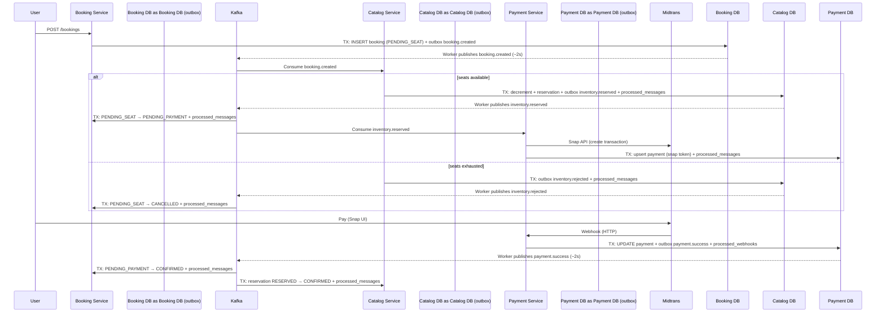

# TripNest: Distributed Travel Booking System

A scalable, **event-driven microservices** system for travel booking, built with Go, **Apache Kafka**, PostgreSQL, and an **outbox pattern** for reliable cross-service messaging.

## System Overview

TripNest coordinates **booking-service** and **payment-service** (and supporting services) using **Kafka topics**, not synchronous HTTP chains, for the payment lifecycle. Both booking and payment services **persist events in PostgreSQL (`outbox_events`) first**; background workers **publish to Kafka** on a short interval (~2 seconds). This matches the **transactional outbox** pattern: the database commit and the intent to publish stay consistent; Kafka delivery is asynchronous.

**Core messaging services (payment flow):**

| Component | Role |
| :--- | :--- |
| **booking-service** | Creates bookings (`PENDING_SEAT`), enqueues `booking.created`, consumes `inventory.reserved` / `inventory.rejected` / `payment.success` / `payment.failed`, confirms or cancels bookings, expires pending bookings (`booking.expired`), announces explicit cancellations (`booking.cancelled`). |
| **catalog-service** (`inventory-service/`) | Owns trips and capacity. Consumes `booking.created` and either holds the seat (`inventory.reserved`) or rejects it (`inventory.rejected`); releases seats on `payment.failed` / `booking.expired` / `booking.cancelled`; publishes `trip.upserted` / `trip.deleted` for the search read model. |
| **payment-service** | Consumes `inventory.reserved`, creates **Midtrans Snap** transactions, exposes snap token HTTP API, handles **Midtrans webhooks**, updates payment rows, enqueues `payment.success` / `payment.failed`. |
| **Kafka** | Carries every topic in the [event catalog](#kafka-details) below. |
| **Outbox** | `outbox_events` in each service DB; a shared worker (`common/outbox`) claims rows with `FOR UPDATE SKIP LOCKED` and publishes to Kafka. |

Other services in the repo (User, Search, Inventory, etc.) support auth, search, and inventory; the table below highlights the main stack.

### Core Services

| Service | Status | Tech Stack | Responsibility |
| :--- | :--- | :--- | :--- |
| **User Service** | ✅ Completed | Go, PostgreSQL, JWT | User registration, authentication, and secure password handling. |
| **Booking Service** | ✅ Completed | Go, PostgreSQL, Kafka | Bookings, outbox, Kafka consumers for payment outcomes, booking expiry. |
| **Payment Service** | ✅ Completed | Go, PostgreSQL, Kafka | Midtrans Snap, webhooks, outbox, Kafka consumer for `inventory.reserved`. |
| **Search Service** | ✅ Completed | Go, MongoDB, Redis | Search optimized for read-heavy workloads. |

### Event Flow (Choreography + Outbox)

Services react to Kafka events without a central orchestrator. **Publishing is not always immediate:** events are written to `outbox_events`, then a worker sends them to Kafka.



Every box labelled **TX** is one Postgres transaction: the business change, the outbox row, and the idempotency record commit together or not at all.

## Payment (Midtrans Snap) — Implementation

- **Provider:** Midtrans **Snap** — HTTP `POST` to `{sandbox|production}/snap/v1/transactions` with **Basic** auth (`serverKey` + `:`).
- **Order ID format:** `ORD-<first 8 chars of booking UUID>-<unix timestamp>` (e.g. `ORD-5c3d4fdb-1776202502`).
- **Snap token:** Returned by Midtrans; stored on the payment row. Exposed via **GET** `/payments/snap-token?booking_id=...` on **payment-service** (port **8082**). If no payment exists yet, the service **fetches the booking** from booking-service and initializes Snap.
- **Webhook endpoints (all POST, same handler):**
  - `/payments/webhook`
  - `/webhooks/midtrans`
  - `/api/payments/webhook/midtrans`
- **Signature:** SHA-512 hex of `order_id` + `status_code` + `gross_amount` + **server key**, compared case-insensitively to `signature_key`.
- **Payment row status (webhook mapping):** Mapped to internal strings **`SUCCESS`** or **`FAILED`** (and outbox topics below). Midtrans `transaction_status` drives mapping (e.g. `settlement` / `capture` with acceptable `fraud_status` → success path).

## End-to-End Payment Flow

1. **Booking created** → persisted with status **`PENDING_SEAT`** and **`expires_at`** set, together with **`booking.created`** in `outbox_events` (one transaction).
2. **catalog-service** consumes **`booking.created`** → decrements `available_slots`, inserts the reservation, and enqueues **`inventory.reserved`** — or, if seats are exhausted, enqueues **`inventory.rejected`** instead. Either way the `processed_messages` row commits in the same transaction.
3. **booking-service** consumes **`inventory.reserved`** → **`PENDING_SEAT` → `PENDING_PAYMENT`**. On **`inventory.rejected`** → **`CANCELLED`**. A booking that never gets an answer is cancelled by a sweeper after `BOOKING_SEAT_TIMEOUT_SECONDS`.
4. **payment-service** consumes **`inventory.reserved`** → creates **Midtrans Snap** transaction (expiry = `expires_at`) → upserts **`payments`** (`PENDING`, `midtrans_order_id`, `snap_token`).
5. **User pays** via Midtrans (Snap in the browser).
6. **Midtrans** calls the payment-service **webhook** (HTTPS POST).
7. **payment-service** validates the signature, **`UPDATE`s payment** by `midtrans_order_id`, inserts **`payment.success`** or **`payment.failed`** into `outbox_events`, and records `processed_webhooks` — one transaction; a duplicate notification rolls the whole thing back.
8. **payment-service outbox worker** publishes **`payment.success`** (or **`payment.failed`**) to **Kafka**.
9. **booking-service** consumes **`payment.success`** → **`ConfirmBooking`** → **`CONFIRMED`** if still **`PENDING_PAYMENT`**; otherwise it emits **`payment.orphaned`**. **catalog-service** consumes the same event and makes the reservation permanent.
10. On **`payment.failed`**, booking-service → **`CANCELLED`** and catalog-service releases the seats. The same release happens on **`booking.expired`** and **`booking.cancelled`**.

## Outbox Pattern

- Every state change and the event it produces are written **in one Postgres transaction**: the booking insert + `booking.created`, the seat decrement + `inventory.reserved`, the webhook update + `payment.success`, and so on. There is no code path that commits an entity and enqueues its event separately.
- Events sit in **`outbox_events`** as **`PENDING`** and are picked up by the worker in **`backend/common/outbox`**, shared by booking-, payment-, and catalog-service.
- The worker claims a batch with **`SELECT ... FOR UPDATE SKIP LOCKED`**, so **several replicas of the same service can run at once** and each event is still published by exactly one of them (verified with two booking-service replicas: 60 events, 60 Kafka messages, 0 duplicates).
- Publishing waits for a broker acknowledgement (`RequireAll`). Only then is the row marked **`PUBLISHED`**.
- On failure the row gets **`retry_count`**, **`last_error`**, and a **`next_attempt_at`** with **exponential backoff** (2 s, 4 s, 8 s, … capped at 5 min). After **`OUTBOX_MAX_RETRY`** attempts (default 8), or immediately for events that can never be sent (empty key, non-object payload), the row becomes **`FAILED`** and is copied to **`outbox_dead_letters`** for inspection and replay.
- Tunables: `OUTBOX_INTERVAL_SECONDS`, `OUTBOX_BATCH_SIZE`, `OUTBOX_MAX_RETRY`, `OUTBOX_BASE_BACKOFF_SECONDS`, `OUTBOX_MAX_BACKOFF_SECONDS`.

## Booking Expiration

- **`expires_at`** is set in **`CreateBooking`**: `now + BOOKING_EXPIRY_MINUTES` (env), with a **minimum window of 10 minutes** enforced in service configuration.
- A **background worker** runs on an interval from **`BOOKING_EXPIRY_INTERVAL_SECONDS`** (default **60**; values below **60** are raised in config; the process also enforces a **minimum 1 minute** tick in code).
- Pending bookings with **`expires_at <= now`** are moved to **`EXPIRED`**; each expiry enqueues **`booking.expired`** on the **booking** outbox, which the same outbox worker publishes to Kafka topic **`booking.expired`**.

## Kafka Details

| Topic | Producer | Consumer(s) | Purpose |
| :--- | :--- | :--- | :--- |
| **`booking.created`** | booking | catalog | Ask for the seats to be held |
| **`inventory.reserved`** | catalog | booking, payment | Seats held: booking moves to `PENDING_PAYMENT`, payment creates the Snap transaction |
| **`inventory.rejected`** | catalog | booking | Not enough seats: booking is cancelled |
| **`payment.success`** | payment | booking, catalog | Confirm booking, make the reservation permanent |
| **`payment.failed`** | payment | booking, catalog | Cancel booking, release seats |
| **`booking.expired`** | booking | catalog | Payment window passed: release seats |
| **`booking.cancelled`** | booking | catalog | Explicit cancel by user/admin: release seats, even for a confirmed reservation |
| **`payment.orphaned`** | booking | *(none yet)* | Money arrived for a booking that is no longer confirmable; recorded for a future refund flow |
| **`trip.upserted`** / **`trip.deleted`** | catalog | search | Keep the MongoDB read model in sync |

Consumer groups: `payment-service-group`, `inventory-service-group`, and one group per topic in booking-service (`booking-service-group-<topic>`).

**Idempotency (at-least-once):** every consumer runs through **`backend/common/inbox`**. For each message it opens one Postgres transaction, runs the handler, then inserts **`(consumer_group, topic, message_key)`** into **`processed_messages`** — in that order, in that transaction. A conflict on the insert means the message was already handled, so the whole transaction rolls back. The Kafka offset is committed only after the database commit. A consumer killed mid-handler therefore re-processes the message after restart (verified by SIGKILL-ing payment-service during Snap creation: the Snap was created 7 s after the container came back, with no manual step). Transient handler errors are retried in place with backoff; the consumer never skips a message it has not finished. Undecodable payloads are the one exception: they are logged loudly and skipped so they cannot block the partition.

**Brokers:** e.g. `kafka:9092` inside Docker Compose; configure via **`KAFKA_BROKERS`**.

## Booking State Machine (actual statuses)

```
                       inventory.reserved                payment.success
  PENDING_SEAT ───────────────────────► PENDING_PAYMENT ─────────────────► CONFIRMED
       │                                    │  │                               │
       │ inventory.rejected                 │  │ payment.failed                │ user/admin cancel
       │ (or no answer within               │  │ user/admin cancel             │ (booking.cancelled)
       │  BOOKING_SEAT_TIMEOUT_SECONDS)     │  └──────────────► CANCELLED ◄────┘
       └──────────────────────► CANCELLED   │
                                            │ expires_at passed
                                            └──────────────────► EXPIRED
```

| Status | Meaning |
| :--- | :--- |
| **`PENDING_SEAT`** | Initial state after **`POST /bookings`**. The booking exists but catalog-service has not yet confirmed the seats. No Snap transaction can be created in this state. |
| **`PENDING_PAYMENT`** | Seats are held (`inventory.reserved`). The only state from which a Snap token can be requested. |
| **`CONFIRMED`** | `payment.success` consumed and the compare-and-set from `PENDING_PAYMENT` succeeded. |
| **`CANCELLED`** | Seats rejected, payment failed, or explicit cancellation. Explicit cancellation of a `CONFIRMED` booking is allowed and releases the seat via `booking.cancelled`. |
| **`EXPIRED`** | Expiry worker found `expires_at` in the past while still `PENDING_PAYMENT`; `booking.expired` releases the seat. |

Every transition is a compare-and-set (`UPDATE ... WHERE status = <expected>`), so a late or duplicate event cannot move a booking backwards. A `payment.success` that arrives for a booking that is no longer `PENDING_PAYMENT` (already cancelled or expired) is not silently dropped: booking-service emits **`payment.orphaned`** so the money is visible for a manual or future automated refund.

## Limitations & Edge Cases (from current code)

- **Webhooks** whose **`order_id`** does **not** start with **`ORD-`** are **ignored** (no DB update, no outbox event) — avoids noise from non–TripNest Snap order IDs.
- **A consumer crash between the Midtrans call and the database commit leaves an unused Snap transaction at Midtrans.** The retry creates a fresh one; the first simply expires. Nobody ever receives the orphaned token.
- **Frontend:** Payment page loads Snap from the sandbox script and requests the token via a Next.js route that proxies to **`http://localhost:8082`** — suitable for local dev; production URLs and secrets must be aligned separately.

## Engineering Decisions

### Choreography-based Saga
Choreography decouples services. Each reacts to Kafka events; there is no central orchestrator process.

### Idempotency
- **Kafka:** `processed_messages` per consumer group / topic / message key, written *after* the handler in the same transaction (see [Kafka Details](#kafka-details)).
- **Payments:** Webhook idempotency uses **`processed_webhooks`** keyed by `order_id:transaction_status`, written in the same transaction as the payment update and the outbox event.
- **Payments:** a Snap transaction is only created once per `booking_id`; a redelivered `inventory.reserved` finds the existing row and does nothing.

### Statelessness & Scalability
Services are containerized; JWT auth is stateless. Consumer groups partition Kafka work across replicas, and the outbox worker's `SKIP LOCKED` claim lets several replicas drain the same table without double-publishing.

### Kafka as Backbone
Kafka provides durability; outbox bridges DB transactions with eventual Kafka delivery.

### Search Optimization (CQRS-lite)
Search uses MongoDB and Redis; transactional data stays in PostgreSQL for user, booking, and payment services.

## Setup Instructions

### Prerequisites
* Docker & Docker Compose
* Go 1.24+ (for local development)

### Environment

Salin `.env.example` menjadi `.env` di root, lalu isi minimal dua nilai:

```bash
cp .env.example .env

# JWT_SECRET wajib >= 32 karakter. Semua service memakai nilai yang sama.
openssl rand -base64 48
```

| Variabel | Wajib | Keterangan |
| :--- | :--- | :--- |
| `JWT_SECRET` | ya | Minimal 32 karakter. Semua service **menolak start** bila kosong atau terlalu pendek. |
| `ADMIN_EMAIL` / `ADMIN_PASSWORD` | ya | Akun admin pertama, dibuat otomatis oleh user-service saat start. |
| `MIDTRANS_SERVER_KEY` / `MIDTRANS_CLIENT_KEY` | ya | Dari dashboard Midtrans sandbox. |
| `CORS_ORIGINS` | tidak | Default `http://localhost:3000`. |

Frontend membaca `NEXT_PUBLIC_MIDTRANS_CLIENT_KEY` dari `frontend/.env.local`.

### Running the System

1. **Build and Start Services**
   ```bash
   docker compose build --no-cache
   docker compose up -d
   ```

2. **Environment (payment-service)**  
   Compose expects **`MIDTRANS_CLIENT_KEY`** and **`MIDTRANS_SERVER_KEY`** from the host environment (see `docker-compose.yml`). Without them, payment-service will not start.

3. **Verify Services**
   * User Service: `http://localhost:8080`
   * Booking Service: `http://localhost:8081`
   * Payment Service: `http://localhost:8082`
   * Search Service: `http://localhost:8083`

4. **Check Logs**
   ```bash
   docker logs -f tripnest-booking-service
   ```

### Frontend Setup

1. **Install Dependencies**
   ```bash
   cd frontend
   npm install
   ```

2. **Run Development Server**
   ```bash
   npm run dev
   ```

3. **Access the UI**
   Open `http://localhost:3000` in your browser.

## Autentikasi

Semua endpoint selain katalog publik, health, dan webhook Midtrans
memerlukan header `Authorization: Bearer <token>`.

| Peran | Cara mendapat token | Hak |
| :--- | :--- | :--- |
| User | `POST /login` di user-service | Membuat booking, melihat & membatalkan booking miliknya sendiri |
| Admin | `POST /login` dengan akun ber-`role=admin` | Semua di atas, plus CRUD trip, kelola inventaris, lihat semua booking & pembayaran |
| Service | Diterbitkan internal, berumur 5 menit | Endpoint `/internal/*` antar service |

Harga booking dan identitas pemesan **tidak pernah** diambil dari request.
Harga dibaca server dari katalog, `user_id` dibaca dari klaim token.

## API Testing (example flow)

### 1. Register
```bash
curl -X POST http://localhost:8080/register \
  -H "Content-Type: application/json" \
  -d '{"email":"user@example.com","password":"password123","first_name":"John","last_name":"Doe"}'
```

Password minimal 8 karakter. Email duplikat dibalas `409`.

### 2. Login
```bash
TOKEN=$(curl -s -X POST http://localhost:8080/login \
  -H "Content-Type: application/json" \
  -d '{"email":"user@example.com","password":"password123"}' | jq -r .token)
```

### 3. Lihat katalog (publik)
```bash
curl "http://localhost:8083/search?destination=Bali&min_price=100000"
curl http://localhost:8083/trips/<TRIP_ID>
```

### 4. Buat booking
```bash
curl -X POST http://localhost:8081/bookings \
  -H "Authorization: Bearer $TOKEN" \
  -H "Content-Type: application/json" \
  -d '{"resource_id":"<TRIP_ID>","quantity":2}'
```

Body hanya berisi `resource_id` dan `quantity`. Mengirim `total_amount`
atau `user_id` akan ditolak `400` -- keduanya ditentukan server.

### 5. Booking saya
```bash
curl http://localhost:8081/bookings -H "Authorization: Bearer $TOKEN"
```

Otomatis dibatasi pada booking milik pemanggil. Admin melihat semuanya.

### 6. Mulai pembayaran
```bash
# Membuat transaksi Snap bila belum ada (idempoten)
curl -X POST http://localhost:8082/payments/snap-token \
  -H "Authorization: Bearer $TOKEN" \
  -H "Content-Type: application/json" \
  -d '{"booking_id":"<BOOKING_ID>"}'

# Membaca token yang sudah ada, tanpa efek samping
curl "http://localhost:8082/payments/snap-token?booking_id=<BOOKING_ID>" \
  -H "Authorization: Bearer $TOKEN"
```

Masa berlaku transaksi Snap disamakan dengan `expires_at` booking, dan
booking yang tidak berstatus `PENDING_PAYMENT` ditolak `409`.

### 7. Endpoint admin
```bash
ADMIN=$(curl -s -X POST http://localhost:8080/login \
  -H "Content-Type: application/json" \
  -d '{"email":"admin@tripnest.local","password":"<ADMIN_PASSWORD>"}' | jq -r .token)

curl -X POST http://localhost:8083/trips \
  -H "Authorization: Bearer $ADMIN" -H "Content-Type: application/json" \
  -d '{"title":"Bali Retreat","destination":"Bali","price":2500000,"date":"2026-12-01","available_slots":12}'

curl http://localhost:8082/payments -H "Authorization: Bearer $ADMIN"
```

`GET /payments` tidak pernah mengembalikan `snap_token` atau
`raw_notification`.

## Known Limitations

Jujur soal apa yang belum selesai, supaya klaim di atas tidak melebihi kode:

- **`payment.orphaned` belum punya consumer.** Uang yang masuk untuk booking yang sudah mati tercatat, tapi refund-nya masih manual.
- **Data customer di Midtrans masih placeholder** (`TripNest Customer`, `user@tripnest.com`), belum diambil dari profil user.
- **search-service belum memakai `processed_messages`** — read model Mongo-nya idempoten secara alami (upsert by id), jadi tidak ada dampak, tapi polanya belum seragam dengan tiga service lain.
- **Belum ada test dan CI.**
- **Token disimpan di cookie yang terbaca JavaScript**, belum httpOnly.

Rencana penyelesaiannya ada di `PLAN-TRIPNEST.md`.
